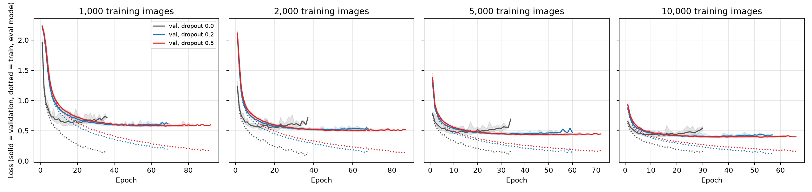
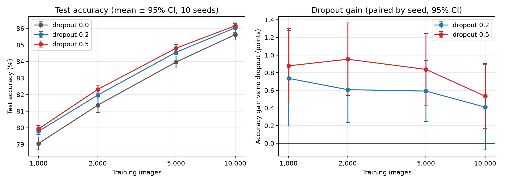
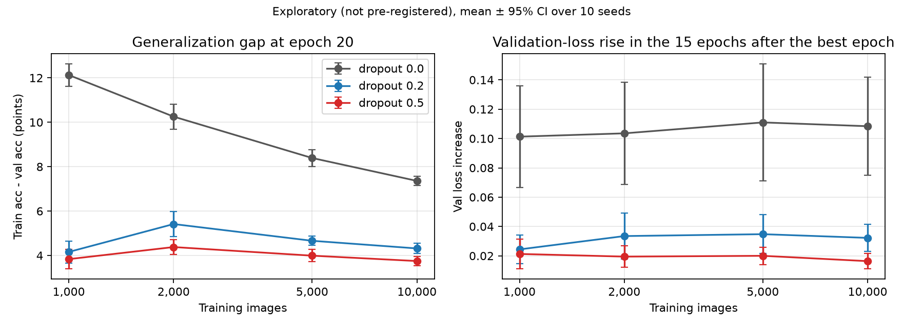
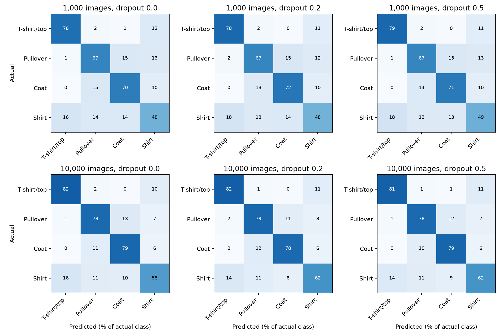

<!-- NHSJS manuscript, standard version (numbered superscript citations). Assembled from the Week 6 section drafts; edit this file from now on. -->

# Beyond Overall Accuracy: Dropout Improves Generalization but Does Not Target Confusion Between Similar Clothing Categories

AUTHORS:Agastya Bhadani1*

AFFIL:1Randor High School; Radnor, United States of America.

## Abstract

Dropout is one of the most common methods for reducing overfitting in neural networks, but it is usually only judged by how much it changes overall accuracy. This study tested how dropout affects both accuracy and the mistakes a network makes between visually similar clothing categories in Fashion-MNIST, and whether these effects change with the amount of training data. A multilayer perceptron with two hidden layers was trained with dropout rates of 0.0, 0.2, and 0.5 on 1,000, 2,000, 5,000, and 10,000 images, using 10 random seeds for each condition (120 runs). The models were trained with early stopping, evaluated once on the official test set, and compared using paired t-tests with Holm correction. This design was built after a 10-epoch pilot study in which dropout showed no benefit. Dropout 0.5 increased test accuracy by 0.53 to 0.95 percentage points, which was statistically significant at all four training sizes, and 7 of the 8 dropout comparisons were significant. Dropout also made the results more consistent across seeds and, in exploratory analyses, greatly reduced overfitting. However, it lowered confusion between T-shirts, pullovers, coats, and shirts by only about one percentage point, which was the same rate as other errors, and shirt stayed the hardest class. The gain from dropout was smaller with 10,000 images, but this difference was not significant. Overall, dropout gave a small but consistent accuracy gain once the networks were trained long enough to overfit, but it did not help them tell similar categories apart.

**Keywords:** dropout, regularization, overfitting, Fashion-MNIST, multilayer perceptron, training set size, error analysis

## 1. Introduction

### 1.1 Background and Context

Neural networks learn to make predictions by adjusting a large number of internal weights so that they fit a set of training examples. Because these networks are so flexible, they can also fit details that only exist in the training examples, such as noise or unusual images, instead of patterns that apply to new data. This problem is called overfitting. An overfit network performs very well on the images it was trained on but worse on images it has never seen, and the risk of overfitting is greatest when the training set is small.1 Dropout is one of the most common methods used to reduce overfitting.2,3 This study looks at which mistakes dropout changes, as well as how many, using a clothing-image dataset in which several categories look alike.

### 1.2 Literature Review

#### 1.2.1 Overfitting and Regularization

Techniques that reduce overfitting are known as regularization methods.1 Zhang et al. showed that standard image-classification networks have enough capacity to fit even randomly assigned labels. This means that the size of a network alone cannot explain why it performs well on new data.4 They also found that explicit regularization helped performance but was neither necessary nor sufficient for good generalization.4 One of the simplest and most common forms of regularization is early stopping, where training is stopped once the performance on a separate validation set stops improving. Prechelt studied how to choose a stopping rule in a systematic way and showed that early stopping involves a trade-off between training time and generalization.5

#### 1.2.2 Dropout

Dropout was first introduced by Hinton et al., who showed that randomly leaving out about half of the hidden units on each training example greatly reduced overfitting.2 Srivastava et al. later described the method in more detail and tested it on vision, speech recognition, document classification, and computational biology tasks.3 They gave two explanations for why dropout works. The first explanation is that because any unit can be removed, units cannot "co-adapt," or depend on specific other units to correct their mistakes, so each unit has to learn features that are useful on their own. The second explanation is that training with dropout samples from an exponential number of smaller "thinned" networks that share weights, and using the full network at test time approximately averages their predictions.3

Later research has given other ways to understand dropout. Wager et al. showed that for generalized linear models, dropout acts as a type of adaptive regularization that penalizes large weights in a way that depends on the data.6 Gal and Ghahramani showed that dropout can be seen as an approximation to Bayesian inference, which allows a dropout network to estimate how uncertain its predictions are.7 More recently, Liu et al. found that dropout can also help models that are underfitting if it is only used early in training, which shows that the effect of dropout depends on the stage of training in which it is applied.8

#### 1.2.3 Dropout and the Amount of Training Data

Srivastava et al. directly tested how the size of the training set changes the benefit of dropout.3 In order to do this, they trained a large network (784-1024-1024-2048-10) on random subsets of the MNIST handwritten-digit dataset that contained between 100 and 50,000 images. For extremely small training sets (100 and 500 images), dropout gave no improvement, because the network could still memorize the training data despite the noise from dropout. As the training set grew, the gain from dropout increased up to a point and then declined. The authors suggested that for a given network and dropout rate, there is a "sweet spot": an amount of data that is large enough that it cannot simply be memorized, but not so large that overfitting stops being a problem.3 However, this experiment only measured the overall error rate, so it did not show whether dropout changed the kinds of mistakes the network made at different training sizes.

#### 1.2.4 Fashion-MNIST and Similar Clothing Categories

Fashion-MNIST was introduced by Xiao et al. as a more challenging replacement for MNIST.9 Like MNIST,10 it contains 70,000 grayscale images that are 28 × 28 pixels, divided into 60,000 training images and 10,000 test images, but its ten categories are clothing items instead of digits. Several of these categories look very similar to each other. Nocentini et al. trained multiple convolutional neural networks (CNNs) on Fashion-MNIST and reached about 94% accuracy, and they found that shirts were the hardest class to recognize because they were mostly confused with T-shirts/tops.11 Hobbs and Shah found something similar, where the errors of their CNN were clustered among upper-body garments (shirts, T-shirts, coats, and pullovers), and they said this was mainly because of the low resolution of the images.12 These studies suggest that confusions between these four categories are a problem that stays even for strong models.

#### 1.2.5 Evaluating Classifiers Beyond Overall Accuracy

Overall accuracy summarizes how a model performs with one number, but it does not show how the errors are spread across the classes. Sokolova and Lapalme reviewed performance measures for multi-class classification, including per-class precision and recall and macro-averaged measures that give each class equal weight.13 Balestriero et al. showed why this matters for regularization. They found that regularization methods such as data augmentation and weight decay can improve average accuracy while greatly reducing the accuracy on certain classes, which means the effects of regularization depend on the class.14 Random variation also affects comparisons between training methods. Bouthillier et al. showed that random factors such as weight initialization and data order can change benchmark results enough to hide real improvements or create ones that are not real, and they recommended repeating experiments in order to account for this.15 Dietterich similarly showed that the choice of statistical test has a large effect on how reliably two learning methods can be compared.16

#### 1.2.6 Gap in the Literature

Based on these studies, dropout reduces overfitting,2,3 its overall benefit depends on the amount of training data,3 the effects of regularization can be different between classes,14 and some Fashion-MNIST categories are consistently confused with each other.11,12 However, none of the studies reviewed here looked at whether dropout changes the specific confusions between visually similar categories, or whether that effect depends on the size of the training set. Answering this question also requires comparisons that account for the random variation between training runs.15

### 1.3 Problem Statement and Rationale

Dropout is usually judged by its effect on overall accuracy, but just because two networks have the same accuracy does not necessarily mean they make the same errors. On Fashion-MNIST, many of the errors come from a few similar clothing categories. Because of this, the main question is whether dropout helps a network separate those categories or if it only lowers the number of errors in general. Dropout is meant to reduce overfitting, and the amount of overfitting depends on the size of the training set, so the answer could also change as more training data becomes available. This study investigates both of these questions together.

### 1.4 Significance and Purpose

Collecting and labeling training data is expensive, so many models in real applications are trained on limited data. In this situation, it is useful to know two things about dropout: how much accuracy it adds at a given training size, and whether it fixes the confusions between similar categories that make up many of the remaining errors. If dropout reduces those confusions, it would be a simple way to improve a model on fine-grained distinctions. If it does not, then those errors need a different approach, such as a different network architecture. The effect of dropout on accuracy can be smaller than the random variation between training runs,15 so in order to measure it, this study uses repeated runs, a held-out test set, and paired statistical tests.

### 1.5 Objectives

The research question for this study is: How does dropout affect the overall accuracy of a neural network and the mistakes it makes when identifying similar clothing categories in Fashion-MNIST, and how do these effects change with the amount of training data?

Four hypotheses were recorded before the final experiment was run:

- H1: Without dropout, the gap between training and validation accuracy grows as the training set gets smaller.
- H2: Dropout reduces that gap at every training size.
- H3: Dropout lowers the within-group confusion rate for T-shirt/top, pullover, coat and shirt, and the reduction is larger at 10,000 images than at 2,000 images.
- H4: The test-accuracy gain from dropout depends on training-set size.

### 1.6 Scope and Limitations

This study focuses on one dataset (Fashion-MNIST) and one type of neural network, a multilayer perceptron (MLP) with two hidden layers. It compares three dropout rates (0.0, 0.2, and 0.5) and four training set sizes between 1,000 and 10,000 images. The analysis of similar categories is limited to four classes: T-shirt/top, pullover, coat, and shirt. The study does not look at CNNs, other regularization methods such as weight decay or data augmentation, or training sets larger than 10,000 images, so the results may not apply directly to other datasets, architectures, or much larger amounts of training data.

### 1.7 Theoretical Framework

This study is based on the idea of the generalization gap, which is the difference between how well a model performs on its training data and how well it performs on new data.1 When a model has too much flexibility for the amount of training data it has, it can memorize the training set and develop a large gap. Regularization methods are designed to reduce this gap. Both of Srivastava et al.'s explanations of dropout, preventing co-adaptation and approximately averaging many thinned networks, predict that dropout should help the most when a network is overfitting, which depends on the size of the training set.3 This framework guided the design of the study in two ways: the effect of dropout should be measured in conditions where the network is able to overfit, and its benefit should change with training size. It also leads to the central question of this study, which is whether reducing overfitting is enough to fix confusions between similar categories, or if those confusions have a different cause.

### 1.8 Methodology Overview

In this study, a controlled computational experiment was conducted in which an MLP was trained on Fashion-MNIST while the dropout rate and the size of the training set were changed. Each of the 12 conditions was repeated with 10 random seeds, and the models were trained with early stopping. After all of the training was complete, the models were evaluated once on the official Fashion-MNIST test set. Overall accuracy, overfitting, and the errors between the four similar clothing categories were then compared using paired statistical tests. This experiment was designed after a smaller pilot study, and the results of the pilot led to the final design. The full methodology is described in Section 2.

## 2. Methods

### 2.1 Research Design

This study was a controlled computational experiment. A neural network was trained to classify Fashion-MNIST images while two factors were changed: the dropout rate (0.0, 0.2, or 0.5) and the number of training images (1,000, 2,000, 5,000, or 10,000). Crossing these two factors gave 12 experimental conditions. Each condition was trained with 10 different random seeds, for a total of 120 final training runs. The reason for using multiple seeds is that random factors such as weight initialization and data order can change the results enough to hide or exaggerate small differences.15

The design is paired. For a given seed, the models with and without dropout started from the same initial weights and saw the training images in the same order. Because of this, each dropout model could be compared directly with its own no-dropout partner, instead of only comparing the group averages.

The final experiment was based on an earlier pilot study conducted in Week 5. The pilot used a smaller network (784-128-64-10) with dropout rates of 0.0 and 0.3 on 2,000 and 10,000 images, using three seeds, a learning rate of 0.1, and a fixed budget of 10 epochs. In the pilot, dropout did not improve validation accuracy at either training size. However, after looking more closely at the training curves, it was clear that the models had not finished learning. Of the 12 runs, 11 reached their lowest validation loss at epoch 9 or 10, and the gap between training and validation accuracy for the models without dropout was only about 4 percentage points. Dropout is designed to reduce overfitting, and the pilot models were not overfitting yet, so the pilot could not fairly test whether dropout helps. In order to fix this, the experiment was redesigned to train longer with early stopping, use a wider network, test more dropout rates and training sizes, use more seeds, and report the results on the official test set.

Before the final runs, the full experimental protocol, including the hypotheses, all of the settings, and the planned statistical analysis, was saved to a configuration file (`q1_dropout_protocol_v2.json`). The code refuses to continue if any setting in this file is changed afterward, which means the analysis plan could not be adjusted after seeing the results.

### 2.2 Participants or Sample

This study did not involve human participants. The sample was the Fashion-MNIST dataset introduced by Xiao et al.9 Fashion-MNIST contains 70,000 grayscale images of clothing items, each 28 × 28 pixels, divided into 60,000 training images and 10,000 official test images. Each image belongs to one of ten categories: T-shirt/top, trouser, pullover, dress, coat, sandal, shirt, sneaker, bag, and ankle boot.

Three separate groups of images were used:

- Training subsets. In Week 1, the 60,000 original training images were shuffled using a fixed seed of 42, and the resulting indices were saved. A fixed set of 10,000 training images was taken from this shuffled order. The smaller training sets were the first 1,000, 2,000, and 5,000 images of this same set, so each smaller set was fully contained in the larger ones. This nesting means the only difference between training sizes is the number of additional examples. Each class was represented in every subset (for example, between 90 and 118 images per class in the 1,000-image subset and between 938 and 1,052 per class in the 10,000-image subset).
- Validation set. A further 5,000 different images were reserved from the original training data (between 465 and 546 per class). These were used only to choose the learning rate and to decide when to stop training. None of these images overlapped with the training images.
- Test set. The official 10,000-image Fashion-MNIST test set, with exactly 1,000 images per class, was used only once, after all 120 final runs were complete, to measure the reported results.

Pixel values were scaled from the range 0 to 255 to the range 0 to 1, which matches PyTorch's `transforms.ToTensor()`. No other preprocessing or data augmentation was used.

### 2.3 Data Collection

In this experiment, each training run is one observation. For every run, the code recorded the training and validation measurements after each epoch, saved the model weights from the selected epoch, and saved the run's final measurements to a CSV file. After all runs were complete, the code evaluated each saved model on the test set and saved its predictions, confusion matrix, and per-class precision, recall, and F1 scores.

All runs were performed on an Apple M4 computer using Python 3.14.0, PyTorch 2.14.0,17 and torchvision 0.29.0. The experiment was run on the CPU instead of Apple's MPS graphics processor for two reasons. First, a timing test showed that for a network of this size, the CPU was about five times faster per epoch. Second, CPU computations give exactly repeatable results. All of the code, settings, data split indices, and raw results are saved in the project repository, so every reported number can be traced back to the run that produced it.

### 2.4 Variables and Measurements

| Type | Variable | Values or definition |
|---|---|---|
| Independent | Dropout rate | 0.0 (no dropout), 0.2, 0.5 |
| Independent | Training set size | 1,000, 2,000, 5,000, 10,000 images |
| Controlled | Network architecture | 784-512-256-10 MLP with ReLU |
| Controlled | Optimizer and batch size | SGD with momentum 0.9, batch size 32 |
| Controlled | Data split | Same training, validation, and test images for every run |
| Controlled | Initialization and batch order | Identical for all dropout rates within a seed |
| Dependent (primary) | Test accuracy | Percentage of the 10,000 test images classified correctly |
| Dependent | Macro-F1 | Average F1 score across all ten classes |
| Dependent | Within-group confusion rate | See below |
| Dependent | Within-group error share | See below |
| Dependent | Shirt recall | Percentage of real shirts predicted as "Shirt" |
| Dependent | Generalization gap | Training accuracy minus validation accuracy at the selected epoch |

Test accuracy was the primary measure because it summarizes the overall performance on images that the model never saw during training or model selection. Precision measures how often a prediction for a class is correct, and recall measures how many of the real examples of a class the model finds. The F1 score combines precision and recall, and macro-F1 averages the F1 score across all ten classes so that each class counts equally.13

To study mistakes between visually similar clothing, the analysis focused on four classes: T-shirt/top, pullover, coat, and shirt. These mistakes were measured in two ways:

- The within-group confusion rate is the number of images from these four classes that were predicted as a different class within the same group, divided by the total number of images from the four classes, multiplied by 100. This is the same measure used in the pilot study.
- The within-group error share is the number of those within-group mistakes divided by all of the mistakes made on images from the four classes, multiplied by 100. This measure separates two possibilities: dropout could reduce mistakes overall, or it could specifically change what kind of mistakes the model makes. If dropout only reduces mistakes overall, then the confusion rate should go down but the error share should stay about the same.

Shirt recall was also recorded because shirt was the hardest class in the pilot study, and in the pilot, dropout appeared to make the model predict "Shirt" less often.

The generalization gap measures overfitting. When a model has memorized its training images, its training accuracy will be much higher than its validation accuracy. In order to make this comparison fair, training accuracy was measured with dropout turned off, in the same way as validation accuracy. In the pilot study, training accuracy had been measured with dropout still active, which made the dropout models look worse on their own training data.

### 2.5 Procedure

Step 1: Network. A multilayer perceptron (MLP) was used. Each 28 × 28 image was flattened into 784 values and passed through two hidden layers of 512 and 256 neurons, each followed by a ReLU activation function, and then into an output layer of 10 neurons, one for each class. The network has 535,818 trainable parameters. The network was made wider than the 128-64 network used in the pilot because a larger network has more capacity to memorize the training images, which is the situation that dropout is designed for. Weights were initialized with PyTorch's default method.

Step 2: Dropout. In the dropout models, a dropout layer followed each hidden layer's ReLU activation, the same placement as in the pilot study. During training, each hidden activation was set to zero with probability p (0.2 or 0.5), and the remaining activations were scaled up by 1/(1 − p) so the average signal size stayed the same. Dropout was turned off whenever the model was evaluated. A rate of 0.5 was tested because it is the hidden-layer rate used by Srivastava et al.,3 and 0.2 as a milder setting. The no-dropout model was identical except that p = 0.

Step 3: Training. Models were trained with stochastic gradient descent (SGD) with momentum 0.918 and a batch size of 32, using cross-entropy loss. The training images were shuffled at the start of every epoch using a random number generator tied to the run's seed. After each epoch, the training loss and accuracy (with dropout off) and the validation loss and accuracy were computed.

Step 4: Early stopping. Instead of training for a fixed number of epochs, each model trained for up to 150 epochs and stopped once its validation loss had not improved for 15 epochs in a row.5 The weights from the epoch with the lowest validation loss were kept as the final model for that run. This let each model train until it stopped improving, which fixed the main problem found in the pilot study.

Step 5: Learning-rate pilot. Dropout can change which learning rate works best, so instead of using one learning rate for every model, a learning rate was selected separately for each dropout rate. Learning rates of 0.003, 0.01, 0.03, and 0.1 were tested for each dropout rate at training sizes of 2,000 and 10,000, using two seeds (0 and 1) that were not used in the final experiment. This made a total of 48 pilot runs. Each pilot run used the same early-stopping procedure, and the learning rate with the lowest average validation loss across its four pilot runs was chosen. Only the validation set was used for this step.

CAPTION:**Table 1 | Learning-rate pilot results.** Mean lowest validation loss across the four pilot runs for each dropout rate and learning rate (lower is better).

| Dropout rate | lr 0.003 | lr 0.01 | lr 0.03 | lr 0.1 | Selected |
|---|---|---|---|---|---|
| 0.0 | 0.4714 | 0.4664 | 0.4833 | 0.6673 | 0.01 |
| 0.2 | 0.4500 | 0.4558 | 0.4767 | 0.7296 | 0.003 |
| 0.5 | 0.4420 | 0.4515 | 0.5237 | 1.2463 | 0.003 |

Step 6: Freezing the protocol. After the learning-rate pilot, all settings, the selected learning rates, the hypotheses, and the analysis plan were saved to the protocol file described in Section 2.1.

Step 7: Final runs. All 120 final models were trained (3 dropout rates × 4 training sizes × 10 seeds: 42, 123, 456, 789, 1011, 2024, 3141, 4242, 5555, and 6789).

Step 8: Test evaluation. Only after all 120 runs were complete, and after the code confirmed that the protocol had not changed, was each saved model evaluated once on the official test set.

### 2.6 Data Analysis

For each training size, each dropout rate was compared with the no-dropout model using the seed pairing described in Section 2.1. For each seed, the difference was calculated between the dropout model and its no-dropout partner (dropout minus no dropout). Across the 10 seeds, the following were reported:

- the mean difference,
- a 95% confidence interval for the mean difference, based on the t-distribution with 9 degrees of freedom,
- a two-sided paired t-test p-value,16 and
- the number of seeds (out of 10) in which the difference was positive.

Because 8 comparisons were made for each measure (2 dropout rates × 4 training sizes), there was a higher chance of getting a false positive. In order to account for this, the p-values within each measure were adjusted using the Holm method,19 and adjusted p-values below 0.05 were treated as statistically significant.

To test whether the effect of dropout differed between 2,000 and 10,000 training images (Hypotheses 3 and 4), the paired differences at the two sizes were compared using Welch's t-test,20 which does not assume the two groups have equal variance.

All of the analyses that were planned in the protocol are reported, including the ones that were not statistically significant. After the results were examined, two additional analyses of overfitting were performed that were not part of the original plan: the generalization gap at a matched point in training (epoch 20, which every run reached), and the increase in validation loss between each model's best epoch and the end of its training. These were compared with the same paired method and Holm correction. Because these analyses were added after the results were seen, they are reported separately as exploratory.

The analysis was carried out in Python using pandas 3.0.5, NumPy 2.5.3, scikit-learn 1.9.1 (for F1 scores and confusion matrices), SciPy 1.18.1 (for the t-tests and confidence intervals), and Matplotlib 3.11.2 (for figures).

### 2.7 Ethical Considerations

This study did not involve human participants, so informed consent was not required. Fashion-MNIST is a publicly available dataset of product images and contains no personal information. To support transparency and reproducibility, all code, the fixed data split, the frozen protocol, and every raw result were saved, and all planned comparisons were reported regardless of outcome. The use of AI-assisted tools is disclosed in the Acknowledgments.

## 3. Results

### 3.1 Pilot Study

In the Week 5 pilot study, dropout did not improve validation accuracy. With 2,000 training images, the mean validation accuracy was 77.83% without dropout and 76.73% with dropout 0.3, and with 10,000 images, it was 83.34% and 82.87%. None of these differences were statistically significant with only three seeds. As described in Section 2.1, the pilot models were still improving when training ended, which is why the experiment was redesigned.

### 3.2 Training Behavior

All 120 final runs stopped early, before reaching the 150-epoch limit, and none diverged. Models without dropout reached their lowest validation loss early in training (median best epoch 13 to 17, depending on training size), while models with dropout took longer (median 33.5 to 49.5 epochs with dropout 0.2 and 43.5 to 65 epochs with dropout 0.5).

Figure 1 shows the average loss curves. Without dropout, the training loss kept going down while the validation loss reached its minimum and then started to rise, which is the typical pattern of overfitting. With dropout, the validation loss went down more slowly, but it stayed almost flat after it reached its minimum.

{width=100%}

CAPTION:**Figure 1 | Training and validation loss curves.** Mean training loss (dotted) and validation loss (solid) over 10 seeds for each dropout rate (colors). Panels from left to right show 1,000, 2,000, 5,000, and 10,000 training images. Shaded areas show the range across seeds; because of early stopping, later epochs average only the runs still training.

### 3.3 Test Accuracy

Dropout improved test accuracy at every training size (Table 2, Figure 2). Accuracy went up with training size for every dropout rate, from about 79–80% with 1,000 images to about 86% with 10,000 images. At every size, dropout 0.5 had the highest mean accuracy, followed by dropout 0.2, and then no dropout. The results with dropout were also more consistent across seeds, because the standard deviation of test accuracy was smaller with dropout than without it in all eight comparisons.

CAPTION:**Table 2 | Test accuracy by training size and dropout rate.** Mean ± standard deviation (%) over 10 seeds, with mean macro-F1 in parentheses.

| Training images | No dropout | Dropout 0.2 | Dropout 0.5 |
|---|---|---|---|
| 1,000 | 79.05 ± 0.55 (0.789) | 79.78 ± 0.25 (0.796) | 79.93 ± 0.28 (0.798) |
| 2,000 | 81.36 ± 0.60 (0.814) | 81.97 ± 0.26 (0.819) | 82.31 ± 0.36 (0.823) |
| 5,000 | 83.96 ± 0.50 (0.838) | 84.55 ± 0.20 (0.844) | 84.80 ± 0.31 (0.847) |
| 10,000 | 85.62 ± 0.46 (0.855) | 86.03 ± 0.38 (0.860) | 86.15 ± 0.24 (0.861) |

Table 3 shows the paired comparisons. Dropout 0.5 improved test accuracy by between 0.53 and 0.95 percentage points, and this improvement was statistically significant at all four training sizes after Holm correction. Dropout 0.2 improved accuracy by between 0.41 and 0.74 points and was significant at 1,000, 2,000, and 5,000 images, but not at 10,000 images, where the 95% confidence interval included zero. Overall, 7 of the 8 accuracy comparisons were significant. The improvement was also consistent for individual seeds. Dropout 0.5 did better than its no-dropout partner in all 10 seeds at 1,000 and 2,000 images, and in 9 of 10 seeds at 5,000 and 10,000 images.

CAPTION:**Table 3 | Change in test accuracy compared with no dropout.** Mean difference in percentage points, paired by seed, with its 95% confidence interval, the Holm-adjusted p-value, and the number of seeds (out of 10) in which dropout was more accurate.

| Training images | Dropout 0.2: gain [95% CI] | Holm p | Seeds improved | Dropout 0.5: gain [95% CI] | Holm p | Seeds improved |
|---|---|---|---|---|---|---|
| 1,000 | +0.74 [0.19, 1.28] | 0.029 | 9/10 | +0.88 [0.46, 1.30] | 0.008 | 10/10 |
| 2,000 | +0.61 [0.24, 0.98] | 0.019 | 9/10 | +0.95 [0.54, 1.36] | 0.004 | 10/10 |
| 5,000 | +0.59 [0.25, 0.94] | 0.018 | 9/10 | +0.84 [0.43, 1.25] | 0.008 | 9/10 |
| 10,000 | +0.41 [−0.07, 0.89] | 0.088 | 7/10 | +0.53 [0.16, 0.90] | 0.029 | 9/10 |

Macro-F1 showed the same direction of effect. Dropout increased macro-F1 by between 0.005 and 0.009 in all eight comparisons, and 5 of the 8 increases were significant after Holm correction.

{width=92%}

CAPTION:**Figure 2 | Test accuracy and dropout gain versus training size.** **A)** Left: test accuracy for each dropout rate (mean ± 95% CI over 10 seeds). **B)** Right: accuracy gain from dropout compared with no dropout, paired by seed (mean ± 95% CI); the horizontal line marks no change.

### 3.4 Overfitting (Hypotheses 1 and 2)

Hypothesis 1 predicted that, without dropout, the generalization gap would grow as the training set got smaller. Using the pre-registered measure (training accuracy minus validation accuracy at the selected epoch), the gap for models without dropout was 9.90 points with 1,000 images, 10.03 with 2,000, 7.30 with 5,000, and 5.71 with 10,000. The gap was therefore larger for the two smallest training sizes than for the two largest, although it was nearly the same at 1,000 and 2,000 images.

Hypothesis 2 predicted that dropout would reduce this gap. Using the pre-registered measure, it did not. The differences between the dropout and no-dropout models ranged from −0.09 to +1.12 points, and none of them were significant after Holm correction. However, this measure compares the models at the epoch each one was selected, which was around epoch 15 for the models without dropout but around epoch 35 to 65 for the models with dropout. Because the no-dropout models were selected before most of their overfitting happened (Figure 1), this measure does not capture how much each model overfit as training continued.

The two exploratory measures, added after seeing the results, compare the models at matched points in training (Table 4, Figure 3). At epoch 20, the generalization gap without dropout ranged from 12.13 points (1,000 images) to 7.36 points (10,000 images), decreasing steadily as training size increased. With dropout, the gap stayed between 3.75 and 5.42 points at every size. Dropout reduced the gap in all 80 seed pairs, by between 3.0 and 8.3 points on average, with the largest reduction at 1,000 images. Similarly, in the 15 epochs after reaching their best epoch, the validation loss of models without dropout rose by about 0.10 to 0.11, while models with dropout rose by only 0.016 to 0.035. All 16 exploratory comparisons were significant after Holm correction (largest adjusted p = 0.007).

CAPTION:**Table 4 | Exploratory overfitting measures (not pre-registered).** Mean over 10 seeds. The gap is training accuracy minus validation accuracy (percentage points) at epoch 20; the validation-loss rise is the increase from each model's best epoch to the end of its training.

| Training images | Gap at epoch 20: no dropout | Dropout 0.2 | Dropout 0.5 | Val-loss rise: no dropout | Dropout 0.2 | Dropout 0.5 |
|---|---|---|---|---|---|---|
| 1,000 | 12.13 | 4.16 | 3.84 | 0.101 | 0.024 | 0.021 |
| 2,000 | 10.25 | 5.42 | 4.38 | 0.104 | 0.033 | 0.019 |
| 5,000 | 8.39 | 4.66 | 3.99 | 0.111 | 0.035 | 0.020 |
| 10,000 | 7.36 | 4.32 | 3.75 | 0.108 | 0.032 | 0.016 |

{width=92%}

CAPTION:**Figure 3 | Exploratory overfitting measures (not pre-registered).** **A)** Left: generalization gap at epoch 20. **B)** Right: rise in validation loss during the 15 epochs after the best epoch. Mean ± 95% CI over 10 seeds.

### 3.5 Errors Between Similar Clothing Categories (Hypothesis 3)

Across all conditions, shirt was the hardest class: its test recall was between 48% and 62%, the lowest of all ten classes. The most common mistakes within the group of four similar classes were shirts predicted as T-shirts/tops (14–18% of shirts) and pullovers and coats predicted as each other (10–15%). These patterns looked similar with and without dropout (Figure 4).

Dropout lowered the within-group confusion rate at every training size (Table 5), by between 0.82 and 1.26 percentage points. All eight reductions had uncorrected p-values below 0.05, but after Holm correction only one remained significant (5,000 images with dropout 0.5: −1.02 points, adjusted p = 0.039).

CAPTION:**Table 5 | Similar-class error measures on the test set.** Mean over 10 seeds for dropout rates 0.0 / 0.2 / 0.5.

| Training images | Within-group confusion (%): 0.0 / 0.2 / 0.5 | Within-group error share (%): 0.0 / 0.2 / 0.5 | Shirt recall (%): 0.0 / 0.2 / 0.5 |
|---|---|---|---|
| 1,000 | 28.5 / 27.3 / 27.3 | 82.3 / 81.3 / 81.8 | 48.3 / 47.9 / 49.2 |
| 2,000 | 26.5 / 25.4 / 25.3 | 84.3 / 82.3 / 83.8 | 57.1 / 54.4 / 54.8 |
| 5,000 | 23.0 / 22.2 / 22.0 | 81.2 / 82.3 / 82.0 | 54.1 / 56.1 / 57.4 |
| 10,000 | 21.8 / 20.9 / 20.9 | 84.3 / 83.8 / 82.8 | 57.9 / 61.9 / 61.5 |

The within-group error share did not change with dropout. About 81–84% of the mistakes on these four classes were confusions with another class in the group, no matter the dropout rate, and none of the differences were significant (all adjusted p = 1.0). This means that dropout reduced the mistakes between similar classes at about the same rate as the other mistakes, so the mix of mistake types stayed about the same. Shirt recall also showed no significant change with dropout (differences from −2.7 to +4.0 points, all adjusted p ≥ 0.59). Because of this, the pattern from the pilot study, where dropout seemed to make the model avoid predicting "shirt," did not show up again.

Hypothesis 3 also predicted that the reduction in within-group confusion would be larger with 10,000 images than with 2,000. This was not supported. The reduction was slightly smaller at 10,000 images (−0.85 vs −1.08 points for dropout 0.2; −0.92 vs −1.26 for dropout 0.5), and the differences between sizes were not significant (Welch's t-test, p = 0.65 and p = 0.56).

{width=90%}

CAPTION:**Figure 4 | Confusion among the four similar clothing categories on the test set.** Each cell shows the percentage of images of the actual class (row) predicted as each class (column), summed over 10 seeds. Top row: 1,000 training images; bottom row: 10,000. Columns: dropout 0.0, 0.2, and 0.5.

### 3.6 Effect of Training Size (Hypothesis 4)

Hypothesis 4 predicted that the accuracy gain from dropout would depend on the size of the training set. The gain was smaller at 10,000 images than at 2,000 images for both dropout rates (+0.41 vs +0.61 points for dropout 0.2, and +0.53 vs +0.95 points for dropout 0.5), and Figure 2 shows the gain staying relatively level from 1,000 to 5,000 images before going down at 10,000. However, the difference between 2,000 and 10,000 images was not statistically significant for either dropout rate (Welch's t-test, p = 0.47 for dropout 0.2 and p = 0.10 for dropout 0.5). The results therefore fit the idea that dropout helps less as the amount of training data increases, but this experiment did not give statistically significant evidence for it.

## 4. Discussion

### 4.1 Why the Pilot Study Found No Effect

The main reason the pilot study found no effect was that the models never had the chance to overfit. In the pilot, each model was only trained for 10 epochs, and the validation loss was still going down when training ended. Because of this, there was almost no overfitting for dropout to prevent, and dropout mainly slowed the learning down, which is why the dropout models in the pilot scored slightly lower. In the final experiment, the models without dropout reached their best validation loss at around epoch 15 and then started to overfit. This is the situation dropout is designed for, and it is where dropout started to show a benefit.

This shows that the number of epochs used for training can change the entire conclusion of a dropout experiment. Liu et al. found something similar, where the effect of dropout depended on the stage of training it was applied in.8 If the study had stopped after the pilot, the conclusion would have been that dropout does not help on Fashion-MNIST, when in reality the problem was that training ended before dropout could make a difference. In order to fairly compare regularization methods, the models need to be trained long enough to overfit, which in this study was done by using early stopping instead of a short fixed number of epochs.

### 4.2 Dropout Prevents Overfitting and Improves Accuracy

The final experiment showed that dropout reduced overfitting and improved test accuracy at all four training sizes. The exploratory measures in Section 3.4 show the overfitting effect the most clearly. At epoch 20, dropout reduced the gap between training and validation accuracy in all 80 seed pairs. Furthermore, after the best epoch, the validation loss only rose by 0.016 to 0.035 for the dropout models, compared with about 0.10 to 0.11 for the models without dropout. These results match the explanation given by Srivastava et al.3 Because random neurons are removed during each training step, no neuron can rely on specific other neurons being there, which stops groups of neurons from "co-adapting" to memorize the training images. Srivastava et al. also describe a dropout network as approximately averaging the predictions of many smaller networks. Averaging tends to make predictions more stable, which could be the reason the dropout models were more consistent across seeds.

The improvement in accuracy was fairly small, between about 0.5 and 1 percentage point. One reason for this is that early stopping was already protecting the models without dropout from most of the overfitting, because each model was saved at its best epoch instead of after it had overfit. Early stopping is a form of regularization by itself,1,5 so the gains in this study show how much dropout adds on top of early stopping. However, just because the gain is small does not necessarily mean it is not useful. With 1,000 training images, dropout 0.5 increased accuracy by 0.88 points, while doubling the training set to 2,000 images without dropout increased accuracy by 2.31 points. This means dropout gave roughly 40% of the benefit of doubling the data, without having to collect any new images.

### 4.3 Effect of Training Set Size

The gain from dropout stayed relatively level from 1,000 to 5,000 training images and was smaller at 10,000 images, although the difference between 2,000 and 10,000 images was not statistically significant. This pattern is similar to the results of Srivastava et al., who found on MNIST that the gain from dropout increased with training-set size up to a point and then declined.3 They also found no improvement at 100 and 500 images, because their much larger network could still memorize the data even with dropout.3 In this study, the smallest training set (1,000 images) still showed a clear benefit. This could be because the experiment did not reach the very small sizes where dropout stops helping, or because the network used here was much smaller than theirs and was less able to memorize such a small training set.

The overfitting measures help explain this trend. Without dropout, the gap at epoch 20 went down from 12.13 points with 1,000 images to 7.36 points with 10,000 images, because a larger training set is harder to memorize. With more data, there is less overfitting for dropout to prevent, which then leads to a smaller benefit from dropout. Testing larger training sets, up to the full 60,000 images, would show whether the gain keeps shrinking.

### 4.4 Dropout and Errors Between Similar Clothing

The original goal of this study was to find out whether dropout changes the kinds of mistakes a network makes, and not just how many. For the four similar classes, the results show that it mostly does not. Dropout lowered the within-group confusion rate by about 1 percentage point at every training size, but the share of errors that stayed within the group did not change. This means that dropout reduced the confusions between T-shirts, pullovers, coats, and shirts at about the same rate as all of the other mistakes. Shirt was the hardest class in every condition, which matches Nocentini et al., who found that shirts were most often confused with T-shirts/tops.11 Furthermore, the most common confusions (shirt with T-shirt/top, and pullover with coat) were the same with and without dropout. Balestriero et al. found that regularization can affect different classes very unequally,14 but this kind of uneven effect did not show up for the four similar classes. However, the other six classes were not analyzed in the same detail.

The most likely reason is that these confusions are not mainly caused by overfitting. Shirts, T-shirts, pullovers, and coats can look very similar in 28 × 28 grayscale images, and an MLP that flattens each image into a list of pixels has no built-in way to detect local features such as collars, buttons, or sleeve shapes. If the errors come from these limits of the model and the images, then a method that reduces memorization, like dropout, would not be expected to fix them specifically. This also explains why Hypothesis 3 was not supported. It predicted that dropout would reduce these confusions more with 10,000 images, but the reduction was about the same at every size. Convolutional neural networks (CNNs), which are designed to detect local visual features,10 may be better at handling these errors. However, previous studies found that shirts, T-shirts, pullovers, and coats are still the most confused categories even for CNNs that reach over 90% accuracy,11,12 which suggests that part of the problem comes from the low-resolution images themselves.

In the pilot study, dropout seemed to make the network avoid predicting "shirt," but this did not happen in the final experiment. The pilot measured each model at its last epoch, while the accuracy was still changing by several points from one epoch to the next. Because of this, the pattern was most likely caused by the models being unstable and undertrained, and not by dropout. Patterns in the errors from only a few runs need to be confirmed with repeated runs before they can be interpreted.15

### 4.5 Measuring Overfitting

Hypothesis 2 was not supported by the measure that was planned in advance, even though the exploratory measures showed a strong effect. The planned measure compared each model at its selected epoch. However, early stopping selected the no-dropout models around epoch 15, before most of their overfitting happened, while the dropout models were selected around epochs 35 to 65. As a result, the measure was comparing models at very different points in training. This makes the result a limitation of the analysis plan, and not evidence that dropout has no effect on overfitting. In future studies, a matched-epoch measure of overfitting should be planned before the experiment is run.

### 4.6 Could the Learning Rate Explain the Results?

The models with dropout used a learning rate of 0.003, while the models without dropout used 0.01. This raises the question of whether the improvement came from the lower learning rate instead of from dropout. The learning-rate pilot (Table 1) suggests that it did not. Without dropout, a learning rate of 0.003 gave a slightly worse validation loss (0.4714) than 0.01 (0.4664), so giving the no-dropout model the lower learning rate would not have helped it. Additionally, the dropout 0.5 models reached a lower validation loss (0.4515) than the best no-dropout setting, even when they used the same learning rate of 0.01. These pilot comparisons only used two seeds and the validation set, so they are supporting evidence and not a formal test. Since 0.003 was the lowest learning rate tested, it is also possible that the dropout models would have done even better with a lower learning rate, which would mean the reported gains are an underestimate.

### 4.7 Connection to Objectives

The objectives of this study were tested through four hypotheses. Hypothesis 1, that models without dropout overfit more with less training data, was mostly supported, because the generalization gap was larger with 1,000 and 2,000 images than with 5,000 and 10,000. Hypothesis 2, that dropout reduces this gap, was not supported by the measure planned in advance, because early stopping selected the models at very different points in training. However, the exploratory measures, which compared the models at matched points in training, showed a large and consistent reduction. Hypothesis 3, that dropout reduces within-group confusion more with 10,000 images than with 2,000, was not supported, because the reduction was small and about the same at both sizes. Hypothesis 4, that the gain from dropout depends on training size, was only partly supported, because the gain was smaller at 10,000 images but the difference was not statistically significant. Looking into why Hypotheses 2 and 3 were not supported pointed to two causes, the timing of early stopping and the likely source of the similar-class errors, and these led to the recommendations below.

### 4.8 Recommendations

Based on these findings, future studies should measure overfitting at matched points in training from the start, in addition to the epoch selected by early stopping. Testing larger training sets, up to the full 60,000 images, would show whether the benefit of dropout keeps shrinking as the amount of data increases. Since the confusions between similar clothing categories did not respond to dropout, the next step for studying those errors would be CNNs, which can detect local features such as collars and sleeves.10 Additionally, because the effect of dropout depends on the stage of training, schedules that only apply dropout during part of training8 could also be compared. Finally, testing learning rates below 0.003 for the dropout models would show whether the reported gains are an underestimate.

### 4.9 Limitations

The main limitation of this study is that it used one dataset, one type of network (a two-hidden-layer MLP), and training sets of up to 10,000 images, so the results may not apply to other datasets, architectures, or larger amounts of data. Additionally, all of the training sets were nested subsets taken from a single fixed data split. Only two nonzero dropout rates were tested, and the dropout models used the lowest learning rate in the pilot grid. The accuracy improvements were also fairly small, under one percentage point. Finally, the exploratory overfitting measures were added after the results were seen, so they should be treated as supporting evidence and not as tests of the original hypotheses.

### 4.10 Conclusion

Overall, this study shows that when a multilayer perceptron was trained long enough to overfit, dropout improved its test accuracy on Fashion-MNIST at every training size from 1,000 to 10,000 images, made its results more consistent across seeds, and in exploratory analyses, reduced the generalization gap at epoch 20 by 3.0 to 8.3 points. The pilot study used the same dropout method but found no benefit, because its 10-epoch budget ended training before the models started to overfit. However, dropout only reduced the confusions between T-shirts, pullovers, coats, and shirts at the same rate as the other errors, so it did not help the network separate these similar categories. In order to reduce those confusions, a model that can detect local image features, such as a CNN, will likely be needed.

## Acknowledgments

The author thanks  Meridyth Tyson for guidance throughout this project This research received no external funding, and the author has no competing interests to declare.

## References

1. I. Goodfellow, Y. Bengio, A. Courville. *Deep learning*. MIT Press, 2016.
2. G. E. Hinton, N. Srivastava, A. Krizhevsky, I. Sutskever, R. R. Salakhutdinov. Improving neural networks by preventing co-adaptation of feature detectors. arXiv preprint arXiv:1207.0580, 2012, https://arxiv.org/abs/1207.0580.
3. N. Srivastava, G. Hinton, A. Krizhevsky, I. Sutskever, R. Salakhutdinov. Dropout: a simple way to prevent neural networks from overfitting. Journal of Machine Learning Research. Vol. 15, pg. 1929–1958, 2014, https://jmlr.org/papers/v15/srivastava14a.html.
4. C. Zhang, S. Bengio, M. Hardt, B. Recht, O. Vinyals. Understanding deep learning requires rethinking generalization. International Conference on Learning Representations (ICLR), 2017, https://arxiv.org/abs/1611.03530.
5. L. Prechelt. Early stopping — but when? In G. B. Orr, K.-R. Müller (eds.), *Neural networks: tricks of the trade*. Lecture Notes in Computer Science. Vol. 1524, pg. 55–69, Springer, 1998, https://doi.org/10.1007/3-540-49430-8_3.
6. S. Wager, S. Wang, P. Liang. Dropout training as adaptive regularization. Advances in Neural Information Processing Systems. Vol. 26, pg. 351–359, 2013.
7. Y. Gal, Z. Ghahramani. Dropout as a Bayesian approximation: representing model uncertainty in deep learning. Proceedings of the 33rd International Conference on Machine Learning, PMLR. Vol. 48, pg. 1050–1059, 2016.
8. Z. Liu, Z. Xu, J. Jin, Z. Shen, T. Darrell. Dropout reduces underfitting. Proceedings of the 40th International Conference on Machine Learning, PMLR. Vol. 202, pg. 22233–22248, 2023.
9. H. Xiao, K. Rasul, R. Vollgraf. Fashion-MNIST: a novel image dataset for benchmarking machine learning algorithms. arXiv preprint arXiv:1708.07747, 2017, https://arxiv.org/abs/1708.07747.
10. Y. LeCun, L. Bottou, Y. Bengio, P. Haffner. Gradient-based learning applied to document recognition. Proceedings of the IEEE. Vol. 86, pg. 2278–2324, 1998, https://doi.org/10.1109/5.726791.
11. O. Nocentini, J. Kim, M. Z. Bashir, F. Cavallo. Image classification using multiple convolutional neural networks on the Fashion-MNIST dataset. Sensors. Vol. 22, pg. 9544, 2022, https://doi.org/10.3390/s22239544.
12. A. L. Hobbs, A. S. Shah. Convolutional neural networks for multi-class image classification: a custom CNN approach on Fashion-MNIST. International Journal of Emerging Multidisciplinaries: Computer Science & Artificial Intelligence. Vol. 4, 2026, https://doi.org/10.54938/ijemdcsai.2026.04.2.611.
13. M. Sokolova, G. Lapalme. A systematic analysis of performance measures for classification tasks. Information Processing & Management. Vol. 45, pg. 427–437, 2009, https://doi.org/10.1016/j.ipm.2009.03.002.
14. R. Balestriero, L. Bottou, Y. LeCun. The effects of regularization and data augmentation are class dependent. Advances in Neural Information Processing Systems. Vol. 35, pg. 37878–37891, 2022.
15. X. Bouthillier, P. Delaunay, M. Bronzi, A. Trofimov, B. Nichyporuk, J. Szeto, N. Mohammadi Sepahvand, E. Raff, K. Madan, V. Voleti, S. Ebrahimi Kahou, V. Michalski, T. Arbel, C. Pal, G. Varoquaux, P. Vincent. Accounting for variance in machine learning benchmarks. Proceedings of Machine Learning and Systems. Vol. 3, 2021, https://proceedings.mlsys.org/paper_files/paper/2021/hash/0184b0cd3cfb185989f858a1d9f5c1eb-Abstract.html.
16. T. G. Dietterich. Approximate statistical tests for comparing supervised classification learning algorithms. Neural Computation. Vol. 10, pg. 1895–1923, 1998, https://doi.org/10.1162/089976698300017197.
17. A. Paszke, S. Gross, F. Massa, A. Lerer, J. Bradbury, G. Chanan, T. Killeen, Z. Lin, N. Gimelshein, L. Antiga, A. Desmaison, A. Kopf, E. Yang, Z. DeVito, M. Raison, A. Tejani, S. Chilamkurthy, B. Steiner, L. Fang, J. Bai, S. Chintala. PyTorch: an imperative style, high-performance deep learning library. Advances in Neural Information Processing Systems. Vol. 32, 2019.
18. I. Sutskever, J. Martens, G. Dahl, G. Hinton. On the importance of initialization and momentum in deep learning. Proceedings of the 30th International Conference on Machine Learning, PMLR. Vol. 28, pg. 1139–1147, 2013.
19. S. Holm. A simple sequentially rejective multiple test procedure. Scandinavian Journal of Statistics. Vol. 6, pg. 65–70, 1979, https://doi.org/10.2307/4615733.
20. B. L. Welch. The generalization of "Student's" problem when several different population variances are involved. Biometrika. Vol. 34, pg. 28–35, 1947, https://doi.org/10.2307/2332510.
